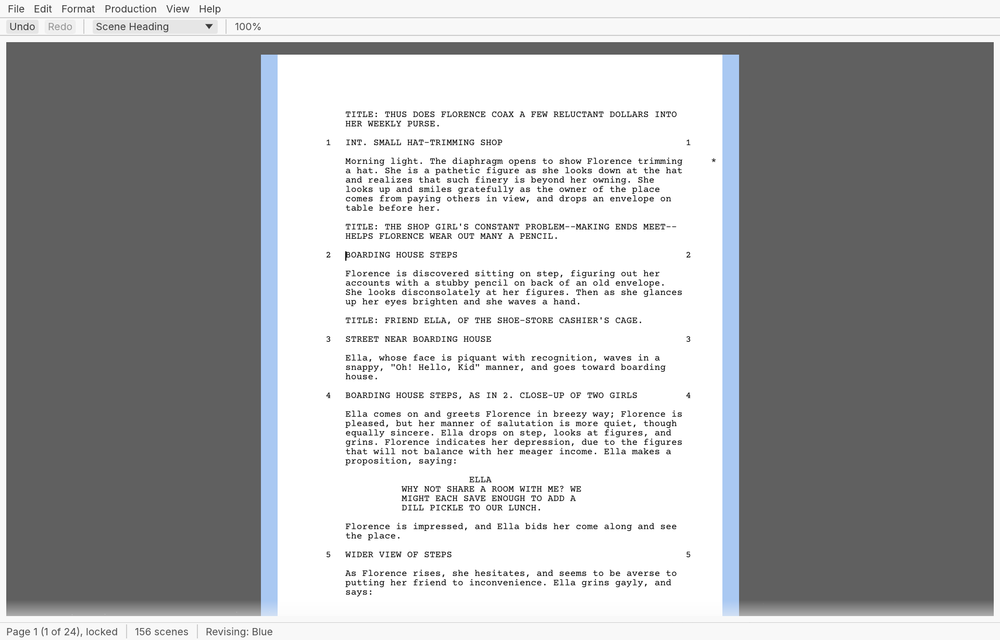
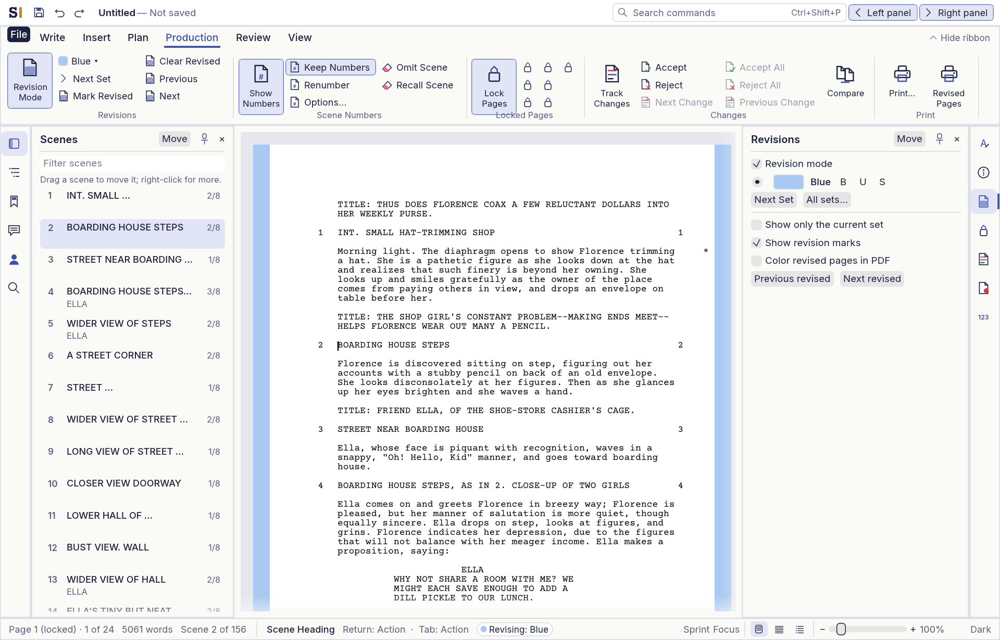
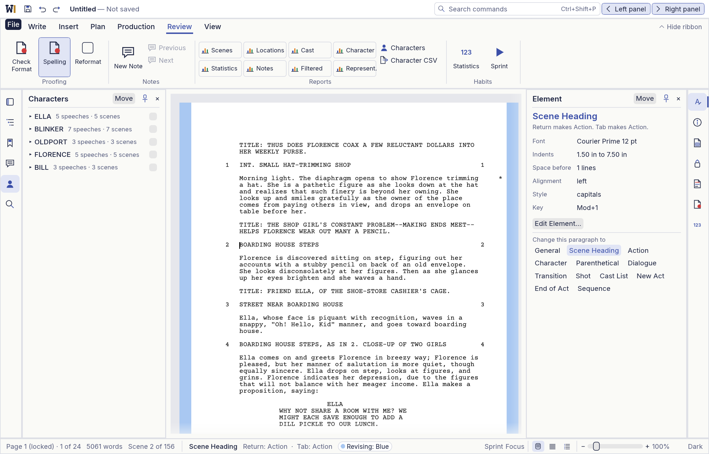
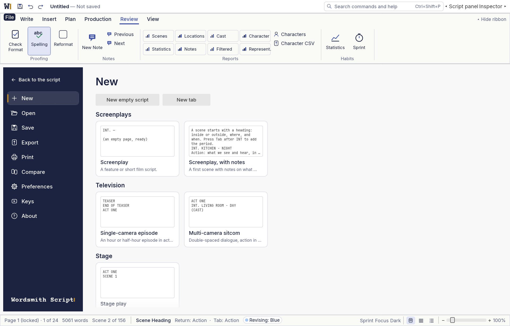
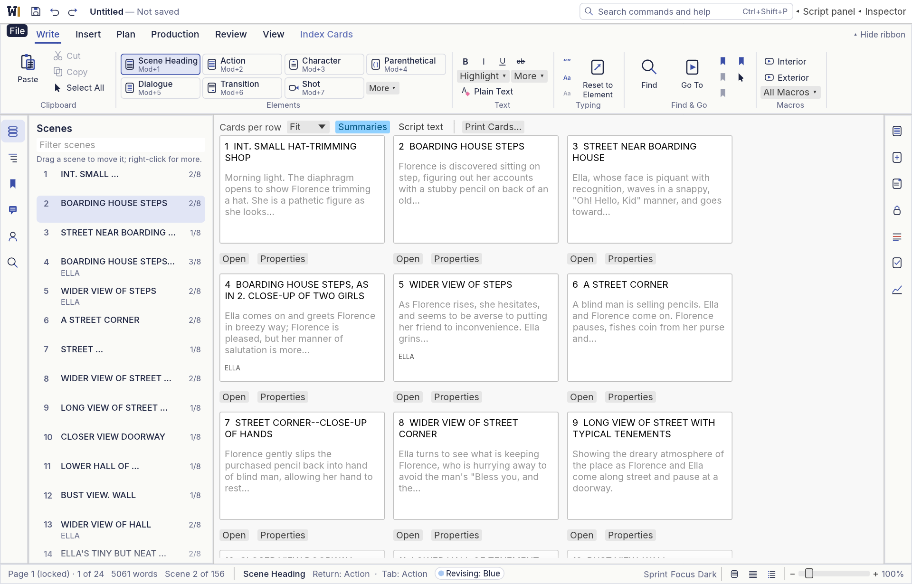
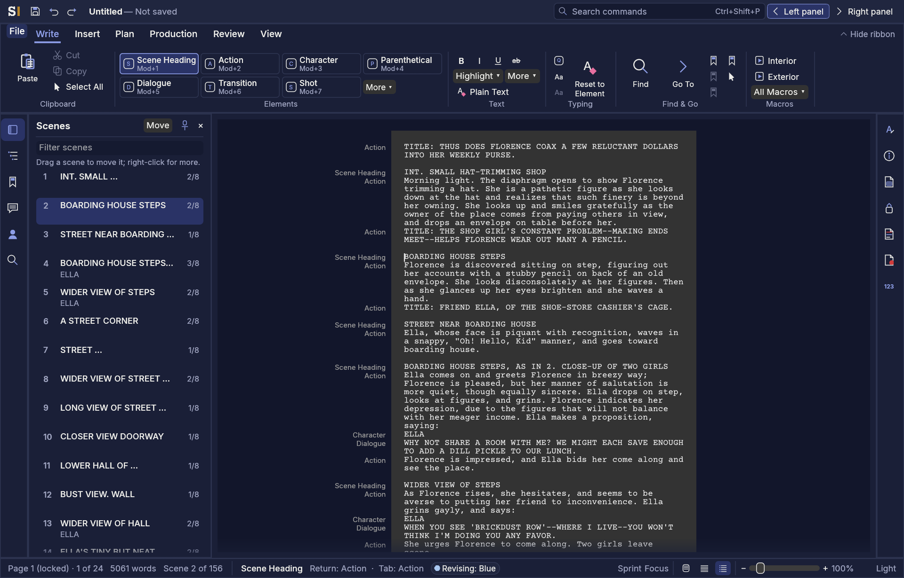

# Wordsmith Script

Licensed under MIT OR Apache-2.0, at your option ([License](#license)).

An open-source screenwriting app for macOS, Windows and Linux, written in
Rust. Type a screenplay with two keys doing the formatting, see it on the
page as it will print, and take it into production with revision colors,
locked pages and scene numbers. Scripts are plain-text files that read well
in `git diff`; Fountain, PDF, RTF, plain text and HTML come and go.

> **A note from the founder**
>
> A lot of work has already gone into laying a solid foundation. The apps aren't ready for everyday use yet, but the idea is sound and the pieces are in place. From here, the plan is slow, steady development and testing.
>
> I've been a wannabe developer for years. AI has finally given me the tools to bring an idea like this together, but my time and resources are limited. Ideas, feedback, bug reports, fixes and feature improvements are all welcome. If you care about this as much as we do, we're also open to deeper partnerships.
>
> I'll keep improving the ecosystem where I can while building out the rest of the foundation.
>
> — Dylan J.



## What it does

- **Writing.** Return and Tab move between scene headings, action,
  characters, parentheticals, dialogue and transitions; autocomplete offers
  names, places and times without ever typing for you; spelling, find and
  replace, notes on any text.
- **Pages.** Industry page layout in Courier Prime: (MORE) and (CONT'D),
  scene CONTINUEDs, headers and footers, a title page, PDF export and
  printing that match the screen.
- **Structure.** Index cards and a scene view that reorder the script, a
  tables panel for scenes, characters and notes, a story board of beats and
  an outline of lanes.
- **Production.** Revision mode on the standard color cycle with margin
  marks, scene numbers with A-scenes and OMITTED, locked pages with A-pages,
  revised-pages-only printing, scene lengths in eighths and a character
  report.
- **Files.** A diff-friendly native format (`.wss`), Fountain both ways,
  import of plain text, RTF and text PDFs, export to RTF, text, HTML and CSV,
  auto-save and timestamped backups.
- **Automation.** `wordsmith-script-cli` converts, exports and reports, and serves
  every command to agents over MCP.

The window has a ribbon of tabs named for screenplay work (Write, Insert,
Plan, Production, Review, View), a Script panel on the left (scenes, outline,
bookmarks, notes, characters, find), an Inspector on the right (the element
and scene at the caret, revisions, the page, tracked changes, the format
checker, goals), a File page for new, open, export and print, and a status
bar that says what Return and Tab will make.

| | |
| --- | --- |
|  |  |
|  |  |
|  |  |

The pictures are drawn by the app itself (`cargo xtask screenshots`) from
"Everybody's Girl" (1918), a public-domain photoplay.

## Getting started

Read the [user guide](docs/guide/README.md). To build and run:

```sh
cargo run --release -p wordsmith-script
```

`rust-toolchain.toml` names the exact Rust release the project builds and
ships with (rustup installs it on first use); the code also builds with Rust
1.95, the minimum supported version, which CI checks. A first build needs
network access to crates.io and to github.com/storytold/craft-libs, where
several dependencies come from (pinned to one commit). The command line:

```sh
cargo run --release -p wordsmith-script-cli -- export-pdf script.fountain script.pdf
```

`cargo xtask package` builds the release package for your computer in
`dist/`, with the license texts of every dependency
(`THIRD-PARTY-LICENSES.txt`) and of the fonts. The packaging and the release
workflow are open-source-core's, the same for every app built on it
([the release contract](https://github.com/jamescjfoundation/open-source-core/blob/main/docs/app-releases.md));
what Script's packages carry is data in `xtask/src/main.rs`.

### Downloads

Release files come only from this repository's
[GitHub releases](https://github.com/jamescjfoundation/wordsmith-script/releases).
The first public release is 0.9.0, a preview (`CHANGELOG.md`). A release has
three packages and their checksums:

| System | File |
| --- | --- |
| macOS, Apple silicon | `wordsmith-script-<version>-macos-aarch64.dmg` |
| Windows, x64 | `wordsmith-script-<version>-windows-x64-portable.zip` |
| Linux, x86_64 | `wordsmith-script-<version>-linux-x86_64.tar.gz` |
| | `SHA256SUMS.txt` |

The programs are not signed with a developer's certificate yet, so macOS and
Windows ask before they open the app the first time. The guide's
[Installing and updating](docs/guide/installing.md) page says how to open it
on each system.

### Checking a download

`SHA256SUMS.txt` on the same release lists every file's checksum
(`sha256sum --check --ignore-missing SHA256SUMS.txt`). Each file also has a
build provenance attestation, which shows it was built from this repository
by the release workflow. The workflow's jobs are open-source-core's, so the
check names it as the signer. With the GitHub CLI:

```sh
gh attestation verify wordsmith-script-<version>-linux-x86_64.tar.gz \
  --repo jamescjfoundation/wordsmith-script \
  --signer-repo jamescjfoundation/open-source-core
```

## Privacy

- **No telemetry.** The app does not report usage, crashes or anything else.
- **Your scripts stay on your computer.** Script content, notes and file names
  are never sent anywhere.
- **The update check** is the only request that leaves your computer. When
  the app starts, and when you choose Check for Updates (on the About page or
  in the Help menu), it asks GitHub's API (`api.github.com`) for this
  repository's list of releases. GitHub sees your IP address and a user agent
  that names the app and its version, nothing else.
  If GitHub's request limit has run out, the check simply fails; it does not
  try another server. An update is downloaded only when you choose to install
  it, from the release on github.com (served from GitHub's own file host).
  The system's proxy settings are used.
- **Turning it off:** clear "Check for updates when the app starts" in File ›
  Preferences (or on the About page). Nothing is sent unless you then check by
  hand. The web build and `wordsmith-script-cli` never check.

## Working on it

Read [CONTRIBUTING.md](CONTRIBUTING.md) first: this repository is public, and it
sets the rules for personal information, security problems, names and copied
code. Report security problems privately, as [SECURITY.md](SECURITY.md) says.

The app is built on
[open-source-core](https://github.com/jamescjfoundation/open-source-core), The
James C. J. Foundation's shared base for its desktop apps: the document model,
layout, PDF, the command engine, the shared document features (notes,
revisions, page locks, bookmarks, watermark, headers and footers, change
tracking, comparison), the window around the script (ribbon, panels, File
page, preferences, updates) and the agent server all come from its `jcj-`
crates. This repository holds what is about screenplays: elements and typing,
pagination with (MORE) and (CONT'D), Fountain and the `.wss` format, scene
numbers, reports, the title page, the story board and the screenplay's
interface. Decision 0044 records what moved where. `AGENTS.md` says how a
change that belongs in the core is made.

Before pushing to `main` or opening a pull request, run the gate:

```sh
cargo xtask ci
```

It runs rustfmt, the crate-root lint check (with no indexing in the
screenplay crates), a check that no local core link is left, a check that every
`jcj-` dependency names one core release, a check that the files and rule
blocks shared with the core match the pinned core release (`cargo xtask
sync --check`), the layers check (no WordCraft or craft-libs crate is named
here), the privacy check, the license allowlist, the asset attribution check,
the brand files against the brand kit's record, clippy and all tests. CI also
runs [cargo-deny](https://github.com/EmbarkStudios/cargo-deny) (`deny.toml`, the
core's) for licenses, security advisories and crate sources. `cargo xtask
wasm` is the web build; it fails until the core's shell builds for the web
(`docs/core-candidates.md`).

- What is planned: the [`v1` milestone](https://github.com/jamescjfoundation/wordsmith-script/milestone/1) of the issues. `ROADMAP.md` links there and holds no list.
- `CHANGELOG.md`: what the next release will bring, and what each release changed. `docs/progress.md`: one line per piece of work landed.
- `docs/gaps.md`: what the app will not do, and why.
- `docs/SPEC.md`: the behavior spec the first build was made from.
- `docs/SPEC-2.md`: the clean-room functional spec for work after it (decision 0030).
- `docs/decisions/`: the choices the specs left open, and the ones made since.
- `docs/format.md`: the `.wss` format. `docs/fixtures.md` and `docs/golden.md`: the files the tests read and the reviewed results they compare with.
- `docs/core-candidates.md`: what the app waits for in open-source-core, and its code that is general enough to move there.
- `docs/performance.md`: how to measure the app's speed, and what keeps it.
- `docs/history/`: the first build's plans, log, spec audits and spec questions, kept for the record. `docs/REUSE.md` and `docs/provenance.md` are history too, and say so.

## Acknowledgments

Wordsmith Script is based on WordCraft by the ArtCraft team. Its document
model, page layout, drawing, PDF output, font handling, command engine and
agent connection are WordCraft's, through
[open-source-core](https://github.com/jamescjfoundation/open-source-core);
`UPSTREAM.md` says how.

It is also built on these open-source projects:

- [craft-libs](https://github.com/storytold/craft-libs): spelling, PDF
  reading and writing, file dialogs, safe saving and the update check.
- [egui and eframe](https://github.com/emilk/egui) for the window and its
  controls, with [AccessKit](https://github.com/AccessKit/accesskit) for
  screen readers.
- [HarfRust](https://github.com/harfbuzz/harfrust) and
  [Skrifa](https://github.com/googlefonts/fontations) for shaping and reading
  fonts, [Vello CPU](https://github.com/linebender/vello) and
  [kurbo](https://github.com/linebender/kurbo) for drawing, and
  unicode-bidi, unicode-linebreak and unicode-segmentation for bidirectional
  text and line breaking.
- The fonts: [Courier Prime](https://github.com/quoteunquoteapps/CourierPrime)
  for the script, and [Inter](https://github.com/rsms/inter),
  [JetBrains Mono](https://github.com/JetBrains/JetBrainsMono),
  [Source Sans 3](https://github.com/adobe-fonts/source-sans) and
  [Source Serif 4](https://github.com/adobe-fonts/source-serif) for the
  interface and documents, all under the SIL Open Font License.
- The public-domain Moby word list by Grady Ward, for spelling.
- [Fountain](https://fountain.io), the open plain-text screenplay format.
- Project Gutenberg, for the public-domain photoplays the tests and pictures
  use.

`ATTRIBUTION.md` lists every asset and copied file with its license, and
`NOTICE` carries the notices the licenses ask for. Every release package has
the license text of each library (`THIRD-PARTY-LICENSES.txt`) and of each
font (its `licenses` folder).

## License

Licensed under either of Apache License, Version 2.0 (`LICENSE-APACHE`) or the
MIT license (`LICENSE-MIT`), at your option. Third-party credits are under
[Acknowledgments](#acknowledgments).
