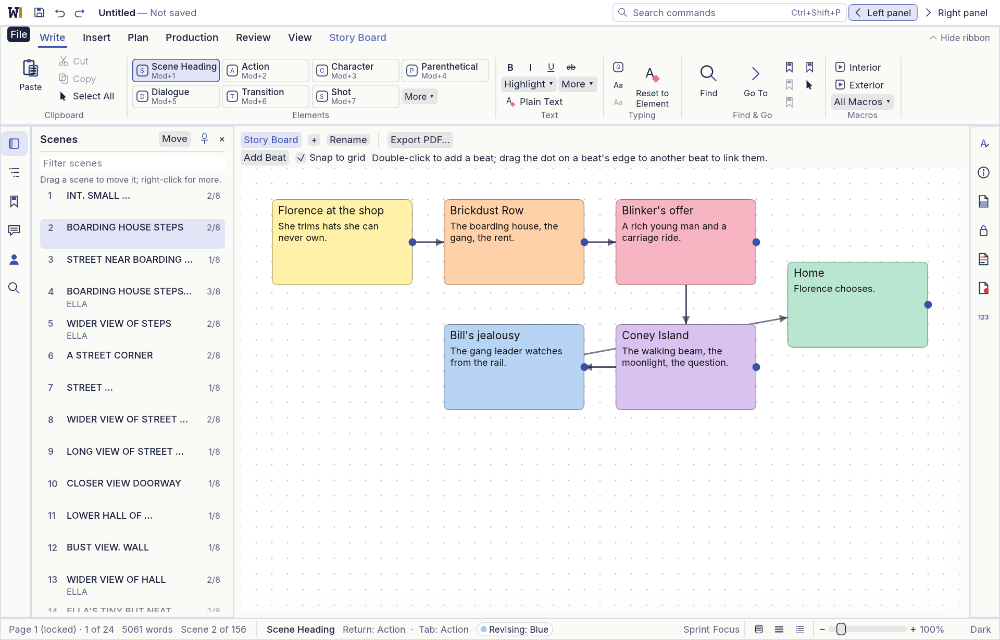
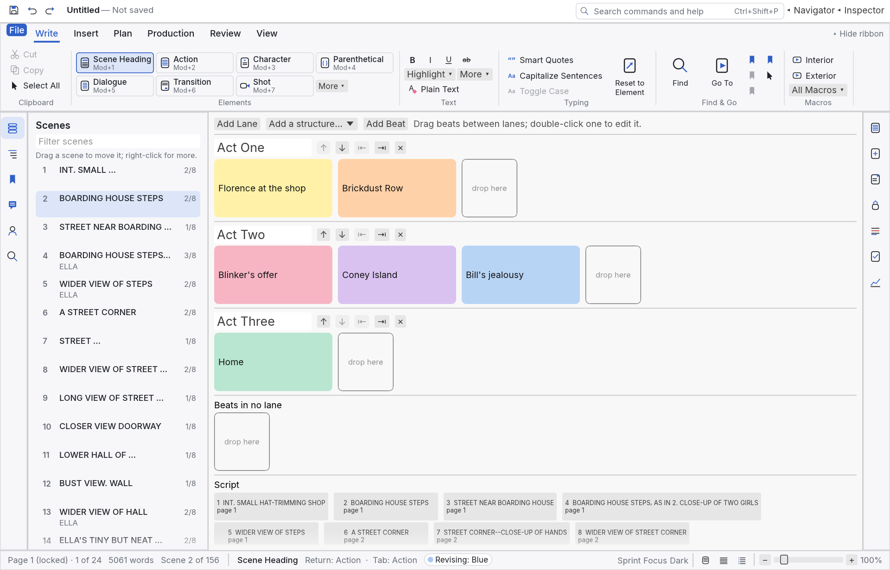
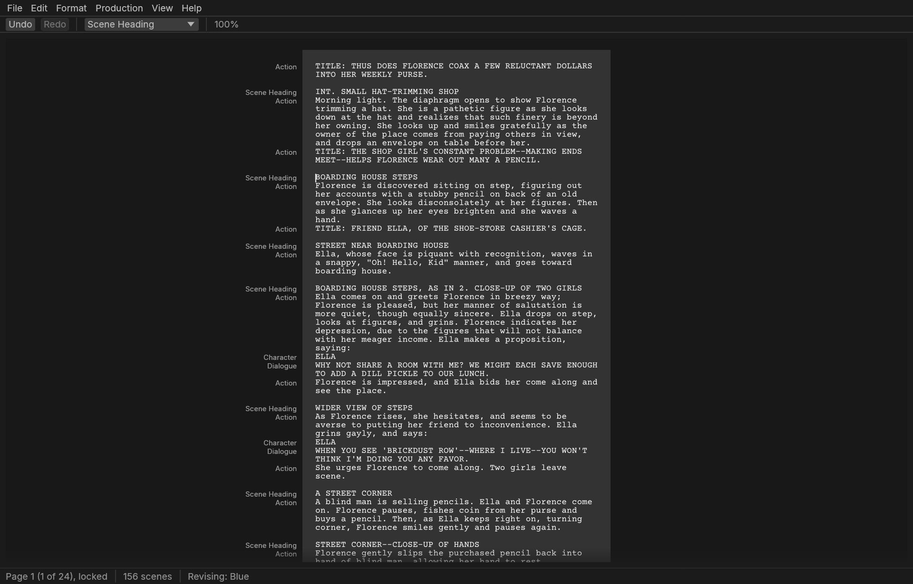

# Wordsmith Script

An open-source screenwriting app for macOS, Windows and Linux, written in
Rust. Type a screenplay with two keys doing the formatting, see it on the
page as it will print, and take it into production with revision colors,
locked pages and scene numbers. Scripts are plain-text files that read well
in `git diff`; Fountain, PDF, RTF, plain text and HTML come and go.

Wordsmith Script is based on WordCraft by the ArtCraft team.


## What it does

- **Writing.** Return and Tab move between scene headings, action,
  characters, parentheticals, dialogue and transitions; autocomplete offers
  names, places and times without ever typing for you; spelling, find and
  replace, notes on any text.
- **Pages.** Industry page layout in Courier Prime: (MORE) and (CONT'D),
  scene CONTINUEDs, headers and footers, a title page, PDF export and
  printing that match the screen.
- **Structure.** Index cards and a scene view that reorder the script, a
  tables panel for scenes, characters and notes, a story board of beats and
  an outline of lanes.
- **Production.** Revision mode on the standard color cycle with margin
  marks, scene numbers with A-scenes and OMITTED, locked pages with A-pages,
  revised-pages-only printing, scene lengths in eighths and a character
  report.
- **Files.** A diff-friendly native format (`.wss`), Fountain both ways,
  import of plain text, RTF and text PDFs, export to RTF, text, HTML and CSV,
  auto-save and timestamped backups.
- **Automation.** `wordsmith-cli` converts, exports and reports, and serves
  every command to agents over MCP.

| | |
| --- | --- |
|  |  |
|  |  |

The pictures are drawn by the app itself (`cargo xtask screenshots`) from
"Everybody's Girl" (1918), a public-domain photoplay.

## Getting started

Read the [user guide](docs/guide/README.md). To build and run:

```sh
cargo run --release -p wordsmith
```

Rust 1.95 or newer (`rust-toolchain.toml` picks the toolchain). The command
line:

```sh
cargo run --release -p wordsmith-cli -- export-pdf script.fountain script.pdf
```

`cargo xtask bundle` builds a release bundle for your computer in `dist/`.

## Working on it

Before merging anything to `main`, run the gate:

```sh
cargo xtask ci
```

It runs rustfmt, a crate-root lint check, clippy, all tests, the license and
asset attribution check, the layering check and the wasm build.

- `docs/SPEC.md`: the behavior spec v0.1 was built from.
- `docs/SPEC-2.md`: the clean-room functional spec for work after v0.1, with its audit, questions and plan (decision 0030).
- `docs/REUSE.md`: what we reuse, and the license and branding rules.
- `docs/decisions/`: the choices the spec left open.
- `docs/spec-audit.md` and `docs/gaps.md`: what v0.1 covers and what it does not.
- `docs/progress.md`: one line per merge. `CHANGELOG.md`: what changed.
- `ROADMAP.md`: what comes after v0.1.

## License

Licensed under either of Apache License, Version 2.0 (`LICENSE-APACHE`) or the
MIT license (`LICENSE-MIT`), at your option. See `NOTICE` and
`ATTRIBUTION.md` for third-party credits.
