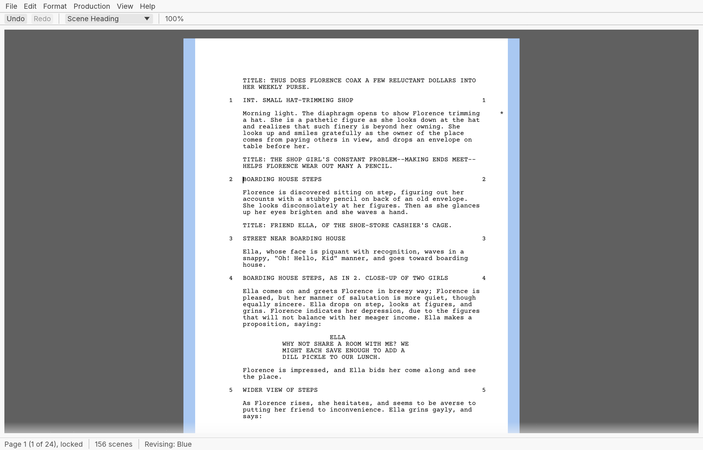

# The window

## Across the top

- **The quick-access row:** save, undo and redo; the script's name and whether
  it is saved; a search box that finds any command by name (Mod+Shift+P); and
  switches for the side panels.
- **The ribbon:**
  - **File** opens the File page.
  - **Write:** cut, copy and paste, elements, text styles, typing options,
    find and go, macros.
  - **Insert:** scenes, page breaks, dual dialogue, notes, the title page,
    header and footer, watermark.
  - **Plan:** cards, scene view, story board, outline, structure strip.
  - **Production:** revisions, scene numbers, locked pages, tracked changes,
    printing.
  - **Review:** check format, spelling, notes, reports, statistics and
    sprints.
  - **View:** script views, panels, split, zoom, themes.
  - **Story Board** and **Index Cards** tabs appear with those views.
- **Ribbon tips:**
  - Point at a control to see its name, key and what it does.
  - Double-click a tab, or use Hide ribbon, to show the tabs only.
  - When the window is narrow, groups drop their labels and then fold into a
    single button.
- **Keyboard access:** press **F10** (or Alt+Space) to show a letter on every
  tab. Press a tab's letter, then the letters on a control to use it. Escape
  leaves.
  - The first 19 controls of a tab have one letter; the rest start with Z
    (ZA, ZB…). No control's letters begin another's.
  - A control keeps its letters while the app runs, even when the window is
    narrowed and its group folds.
  - A drop-down (More, Highlight, All Macros, a folded group) has letters
    too: they open it, and its items then show letters of their own.
- **Every control is a command:** anything on the ribbon, in the
  quick-access row or in the status bar is also in the command search box,
  and can be given a key on the Keys page.
- **Shift with a key that moves the caret** (an arrow, Home, End, Page Up,
  Page Down, with or without Mod) extends the selection, whatever key you
  have given the movement. A shifted key you have given a command of its own
  runs that command, and one you have turned off does nothing.

## The sides

- **The Script panel** (left rail):
  - **Scenes:** click to go, drag to move, right-click for more.
  - **Outline:** acts, sequences and outline paragraphs as a tree.
  - **Bookmarks.**
  - **Notes:** edit in place.
  - **Characters:** highlight, traits, rename.
  - **Find:** results in context, with replace. It shares its search with the
    find bar (Mod+F): close the bar and the panel keeps its results.
- **The Inspector** (right rail):
  - **Element:** what Return and Tab make, its formatting, change it.
  - **Scene:** title, color, summary, who is in it, arc beats.
  - **Revisions.**
  - **Page:** lock tools, page number, scene numbers.
  - **Changes:** accept or reject each tracked change.
  - **Check Format.**
  - **Goals.**

Click an icon to open its panel, and again to close it. Drag a panel's edge
to resize it. The app remembers which panels were open and how wide they were.

## The bottom

The status bar shows:

- **On the left:** the page (with its label when locked), words and scene.
  Click them to go somewhere, see statistics or show the scenes.
- **In the middle:** the caret's element and what Return and Tab make, plus
  chips for revision mode, tracking and dual dialogue. A chip opens its
  panel.
- **On the right:** a sprint, focus mode, the theme, the view switches and
  the zoom.

## The File page

File opens a page in place of the script:

- New (templates, recent scripts, first steps)
- Open
- Save
- Export
- Print (every choice, with Preview)
- Compare
- Preferences
- Keys
- About

Escape or Back returns to the script.

The first time the app starts, a short tour points out these parts. Skip it
whenever you like.

## Updates and privacy

When it starts, the app asks GitHub whether a newer version has been
released. **About** on the File page has **Check for Updates** and shows the
result; Help › Check for Updates… does the same. When an update is available
you can install it (on Linux) or open its release page.

What the check sends, and how to stop it:

- The app asks GitHub's API (`api.github.com`) for the list of Wordsmith
  Script releases. GitHub sees your IP address and the app's name and version
  (`WordsmithScript/0.1.1`), nothing about you or your scripts. If GitHub's
  request limit has run out, the check fails quietly; no other server is
  asked.
- An update is downloaded only when you choose to install it, from the
  release on github.com.
- To turn the check off, clear **Check for updates when the app starts** in
  File › Preferences, under Starting (the same box is on the About page).
  The app then sends nothing unless you check by hand.

The app has no telemetry: it never reports usage or crashes, and your
scripts, notes and file names never leave your computer.
